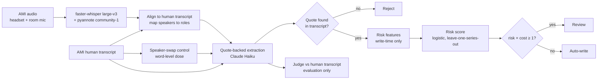

# Meeting Insight Trust

**Which meeting insights are safe to write to a CRM automatically, and which need a person?**

Meeting assistants extract decisions, action items, owners and figures from calls and increasingly write them straight into systems of record. This project measures, on real meeting audio, how often those insights are wrong, why, and whether a risk score can route the risky ones to review. It is an offline evaluation on a public corpus with a static review console; it has not been tested against any vendor's production system.

## The story

**Why I built this.** Meeting assistants are moving from writing notes to taking actions: updating CRM fields, creating tasks, scheduling follow-ups. Once an agent writes to a system of record, a wrong insight stops being a bad summary and becomes bad data that someone acts on. The question I wanted to answer is the one every team shipping these agents faces: which writes can safely happen automatically, and which should stay with a person? I could not test anyone's product, so I measured it on real meeting audio where the right answers are known.

**What is in it.** 24 real meetings (six teams, four meetings each) from the public AMI corpus, each transcribed four ways: an accurate human transcript, the same words with speakers deliberately mixed up, headset speech recognition, and a single room microphone. From each I extracted decisions, action items, owners, costs and risks, every one tied to a quote, then labelled them right or wrong, trained a risk score, defined an explicit write policy, and tested three ways of keeping a project record current across meetings. The console in `web/` lets you replay it all: hear the meeting, see every insight and its risk, and follow each write to where it lands. The whole pipeline cost about $3.40 in compute and API calls.

**What it found.** Speech-recognition confidence, the obvious thing to gate on, barely predicts which insights are wrong. On realistic transcripts, a trained risk score ranks insights no better overall than the extractor's own confidence, but it catches far more of the expensive mistakes: 50% of wrong owners, figures, decisions and costs versus 34%, when a fifth of insights go to review. Most errors are the model's, not the microphone's; the commonest is a suggestion recorded as a decision. And refusing to update a record without a quote left a quarter of its facts out of date, while re-summarizing with a review gate stayed current for about two human checks per meeting.

**What went wrong along the way.** My first automated reviewer agreed with a human only about half the time; the rules for what counts as a decision were ambiguous, so I rewrote them, re-audited three times, and report all three results (final agreement 66%, which is fair, not strong). My first headline number was flattered by including clean transcripts; after an outside code review I re-ran everything on speech-recognition output only, and the overall gain over a simple baseline disappeared. The evidence-only memory strategy I expected to win came last. A control experiment first missed its target dose by up to six points and had to be rebuilt. Each of these is fixed or disclosed in the findings below.

**How this can help a team building meeting assistants.** Don't gate automatic writes on speech-recognition confidence. Gate on what kind of claim it is and how sure the extractor was, with the cost of a wrong write stated per field type, and expect owners and deadlines to need the most review. Send unquoted record changes to a person rather than blocking all of them, because blocking quietly freezes the record. And treat "what counts as an agreed decision" as product policy, not a model setting: careful reviewers disagree on it. The pieces here (JSONL in and out, the write-policy module, the evaluation harness, the review console) are built to be pointed at another team's extraction pipeline.

**How I can help.** I'm an AI engineer (MS in Data Science, University at Buffalo) who builds LLM systems with the evaluation built in: agents with LangGraph, RAG and GraphRAG, fine-tuning (a Qwen2.5-Coder-7B text-to-SQL model), and eval harnesses like this one. This project runs end to end: a GPU speech pipeline, quote-backed LLM extraction, a judge validated against blind human audits, a risk model evaluated on held-out teams, and a product-style review interface. I'm looking for a team building AI that acts on conversations. More about me: [deven-portfolio-website.web.app](https://deven-portfolio-website.web.app).

## See it in three steps

Needs only [Node.js](https://nodejs.org) 20 or later. No Python, API keys or GPU: every result is precomputed and committed.

```bash
git clone https://github.com/ShahaDeven/Meeting_Insight_Trust.git
cd Meeting_Insight_Trust/web
npm install && npm run dev
```

Then open http://localhost:5176. Start on **Meeting review** with meeting c and the room microphone, click an amber diamond on the timeline, then follow a card's **Lands in** links to see where that write ends up.

## Findings

All numbers are on 24 real meetings (6 four-meeting series, 12.1 hours per microphone) from the AMI corpus. 95% intervals resample whole recording series, because meetings in a series share a team, room and microphone.

**1. On real speech-recognition output, a risk score earns its place on the expensive errors, not overall.**
Evaluated only on headset and room-microphone ASR transcripts (643 insights, 19% judged wrong), the input a meeting bot actually receives:

| Rank insights by | AUROC | Wrong caught when the riskiest 20% are reviewed | Wrong left among auto-writes |
|---|---|---|---|
| Trained risk score (logistic regression) | 0.72 | 48% | 12.1% |
| The extractor's own confidence | 0.72 | 40% | 13.8% |
| Speech-recognition confidence on the quote | 0.57 | 29% | 16.5% |

Ranked overall, the trained score is **no better** than the extractor's self-reported confidence (paired AUROC difference +0.003, 95% CI −0.034 to +0.045). Its advantage is on errors that matter for a CRM write: at a 20% review budget it catches **50% of wrong owners, wrong figures, wrong decisions and wrong cost figures, against 34%** for the extractor's confidence (+16 points, 95% CI +5 to +28). Recognizer confidence, the obvious signal to gate on, is the weakest. The human-transcript and speaker-swap runs score higher (AUROC 0.79 and 0.81) and are kept out of these numbers as experimental controls.

**2. An explicit write policy: auto-write, review or reject.**
An insight is *rejected* if no quote in the transcript backs it, *held for review* if `risk × cost[type] ≥ 1` (expected cost of a wrong write exceeds one human review), and *auto-written* otherwise. Costs are a stated assumption in review-units: decision 5, action item 6, cost figure 8, open risk 2. On ASR output the policy reviews 33% of insights, catches 59% of wrong ones (94% of wrong owners) and leaves 11.4% wrong among automatic writes, down from 18.5%. The risk is the model's out-of-fold probability, **not post-hoc calibrated**; on held-out series it tracks observed error but runs low at the bottom (predicted 3%, observed 8%). See `risk/policy.py`.

**3. Most wrong insights are the model's mistake, not the microphone's (exploratory).**
The same meetings were extracted from four transcripts that differ in one thing at a time: human transcript 12.5% wrong [10.1, 15.3], speaker labels swapped 13.1%, headset ASR 17.7%, room-mic ASR 19.3% [15.4, 23.2]. Swapping speakers at each meeting's measured dose adds +0.6 points [−2.1, +2.9], indistinguishable from zero; the room microphone adds +6.2 [+2.8, +9.4]. The commonest error everywhere is a suggestion recorded as a decision. Noise damage is mostly non-local: wrong far-field insights are barely more likely than correct ones to have misheard words in their own quote (51% vs 44%), so the loss is elsewhere, such as a later reversal or a hedge that was not transcribed.

**4. Quote-only memory freezes the record (preliminary, 3 series).**
Keeping a project record across four meetings, judged on 100 human-verified facts after the last meeting:

| Strategy | Correct (human / room-mic transcript) | Out of date | Never true |
|---|---|---|---|
| Evidence ledger (change only with a quote-backed insight) | 44% / 36% | 25–31% | 1–9% |
| Re-summarize (rewrite the record each meeting) | 64% / 60% | 11–17% | 7–11% |
| Re-summarize with a review gate (unquoted changes wait for a person) | 65% / 57% | 13–16% | 3–7% |

Refusing changes without a quote leaves a quarter of facts stale, because people rarely state "that task is done" in a quotable sentence. The gate costs about two reviews per meeting. With three series, differences of a few points are within noise.

## How far to trust the labels

"Wrong" comes from a strict LLM judge (Claude Haiku) that reads each insight against the AMI **human** transcript around its quotes and is blind to the condition. It was audited against blind human labels three times, and all three are reported:

| Audit | Rows | Agreement | Cohen's κ |
|---|---|---|---|
| First blind audit (rubric ambiguous about decisions and reversed facts) | 99 | 55% | — |
| Blind test after the rubric was fixed (reviewer reports marking too fast) | 50 | 52% | 0.04 |
| Final structured blind audit, pre-committed, judge labels hash-frozen | 29 | 66% (47–80%) | 0.27 |

Agreement is fair, not strong. The judge is reliable when it says *correct* (14/16) and over-flags *wrong* (5/13), so it is a stricter reviewer than the human. There is one human rater, the final audit is small, and before it the rater was shown four rows where his marks contradicted the written rules. The hard calls, whether a suggestion was really agreed and whether a fact was later reversed, are policy, which is what should stay with people. A larger audit with a second rater is the main open item.

## Method



- **Transcripts.** Four conditions per meeting: the AMI human transcript; the same words with a share of speaker turns relabelled to hit each meeting's measured far-field speaker-error rate (all 24 within ±0.5 points); and Whisper large-v3 on the Mix-Headset and Array1-01 room-microphone recordings with pyannote speaker labels. Normalized WER against the human transcript: headset 21.8%, room mic 30.3% (deletions dominate, mostly in overlapping speech).
- **Speaker roles.** Diarization clusters are mapped to AMI roles by maximum time overlap with the human transcript. This is an oracle mapping (a live bot gets names from the meeting platform), so the remaining speaker errors are words placed in the wrong cluster.
- **Extraction.** Decisions, action items (owner, deadline), cost figures and open risks, each with 1–3 quotes. The code locates every quote in the transcript and stores the transcript's own words and timestamps; insights whose quote cannot be found are rejected. It does not yet check that a found quote supports the claim's meaning.
- **Risk model.** 22 features available at write time (insight type, owner, the extractor's confidence, quote match, recognizer confidence, hedge and agreement words, turn density). Nothing derived from the human transcript is used (a test enforces this). Logistic regression was fixed as the primary model in advance; XGBoost is a secondary check with series-grouped calibration folds.
- **Memory.** Gold is a model-drafted, human-verified state table per series (the reviewer accepted 98 of 102 draft rows, deleted 2 and added 2); only 3 of 6 series have one.

## Console

`web/` is a static React review console over precomputed results for one four-meeting series (TS3003):

- **Meeting review:** the timeline with recognizer confidence and who spoke when, the transcript with low-confidence words marked, and insights in *held for review / written automatically / rejected* lanes, each with its quotes, play-from-here audio, the reason for its lane, and links to where it lands.
- **Destinations (simulated):** a *Project record* whose current fields are kept up to date across the four meetings by re-summarizing with an evidence gate (written changes show before → after and the quote behind them; unquoted changes wait for approval), the meeting notes, *Tasks* with owner roles and due points, and a *Calendar* of follow-ups. Approve, Edit and Reject change the page only.
- **Write log:** every write across the series in order, with its writer, destination, before → after, status and reason, linking both to the destination and back to the source moment.
- **Memory study** and **What we measured:** the experiments and findings above.

It includes the TS3003c moment where the room microphone splits "I don't have any information on pricing, so I'll have to ask the manufacturing department" between two speakers.

```
python -m app.export          # writes web/public/data/*.json and web/public/audio/*.mp3
cd web && npm install && npm run dev
```

## Reproduce

Requires Python 3.11 and Node 22. All commands run from the repo root; every stage reads and writes files under `data/`, so any stage can be rerun alone.

| Step | Command | Needs | Cost / time (measured) |
|---|---|---|---|
| Speech recognition + speaker labels | `bash gpu/setup.sh && bash gpu/run.sh` on a CUDA 12.8 GPU pod | GPU, `HF_TOKEN` | $0.35, 16 min for 24 h of audio (RTX 5090) |
| Annotations | Download `ami_public_manual_1.6.2.zip` from the AMI site into `data/ami/` | — | — |
| Transcripts, alignment, swap control | `python -m pipeline.build` | — | ~30 s |
| Extraction (3 clean runs) | `python -m extract.extractor --clean-runs 3` | `ANTHROPIC_API_KEY` | $0.004 and ~21 s per meeting transcript |
| Judge labels | `python -m evals.judge` | API | $0.0025 per insights file |
| Attribution | `python -m evals.attribution` | — | seconds |
| Risk features, model, policy | `python -m risk.features && python -m risk.train && python -m risk.policy` | — | ~1 min |
| Memory (3 strategies) + scoring | `python -m extract.memory_strategies && python -m evals.memory_score` | API | $0.80 total |
| Console data | `python -m app.export` | ffmpeg | seconds |

- **Models:** `claude-haiku-5-5` for extraction, judging and memory (effort medium; high for judging and matching), `claude-sonnet-5-5` once to draft the state tables; faster-whisper `large-v3`; pyannote `speaker-diarization-community-1` (pyannote.audio 4.0.7, CTranslate2 4.8.3, torch 2.8.0).
- **Seeds and determinism:** speaker swap seeded per meeting; bootstraps seeded; Claude Haiku 5.5 does not accept a temperature setting, so extraction is repeated three times on clean transcripts to measure run-to-run variation (19% mean spread in insight count).
- **Spend control:** every call is priced from its usage and logged to `data/results/llm_usage.jsonl`; a hard cap (`MAX_USD`, default $10) stops a run. Total for every experiment here: $3.04 of API calls plus $0.35 of GPU.
- **What is committed:** code, tests, and everything the console needs: its precomputed data (`web/public/data`) and one series' re-encoded audio (`web/public/audio`, 53 MB). Not committed: raw AMI audio and annotations, transcripts and model outputs (regenerate with the steps above; `python -m app.export` rebuilds the console's data and audio).
- **Tests:** `pytest -q` (no API key or corpus data needed); CI runs them and the web build on every push.

## Limits

- AMI meetings are product-design sessions, not sales calls; six series and 24 meetings are a small set and do not show generalization to other meeting types.
- Whisper may have seen AMI in training, so its error rates here are likely optimistic.
- Labels come from an LLM judge with fair agreement with one human rater (above).
- The speaker swap is a dose-matched synthetic control (whole-turn relabels), not a replica of real diarization errors.
- Attribution shares split error rates; mishearing and speaker mix-ups can affect the same insight.
- Quote validation checks that a quote exists, not that it supports the claim.
- Not validated on any vendor's product or data.

## Data and license

AMI Meeting Corpus (Carletta et al., 2005). The corpus distribution states that its signals, transcriptions and released annotations are under [CC BY 4.0](https://creativecommons.org/licenses/by/4.0/). This repository does not include raw corpus files. The console includes the audio of one series (TS3003a–d, re-encoded at 24 kbps) and derived transcripts, redistributed under CC BY 4.0 with this attribution. Speech recognition: Whisper (MIT). Diarization: pyannote community-1 (CC BY 4.0).
